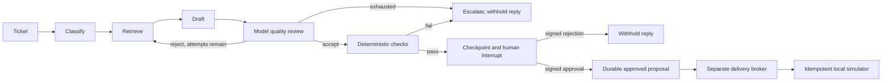

# Governance and failure model

## Workflow

A maximum of two model-review attempts bounds the redrafting loop. Failed
provider calls raise and leave an unfinished checkpoint instead of converting
an error into a customer response. Resuming may repeat an interrupted model call;
completed nodes remain checkpointed. Delivery is not a model tool.

## Authority boundary

The registration compiler rejects missing owner/team/suite/gate fields, unknown
autonomy classes and grants other than reply proposals. Its registry is trusted
application configuration, not ticket content. The planner receives no signer,
broker, arbitrary command execution or generic ticket-update interface.

A trusted local operator reviews the full `{ticket_id, body}` proposal and supplies
its canonical SHA-256 hash. The authority verifies reviewer role/team and signs a
receipt bound to thread, proposal digest, actor, team, decision and expiry. The
graph verifies the signature after interrupt/resume. A bare `true` or an arbitrary
`approved` field is insufficient. The broker verifies the accepted receipt again.

The signing key is persisted separately from graph state. On POSIX it is created
with mode 0600; inherited Windows ACLs and all data-directory access remain the
operator's responsibility. This is not a hardened secrets service. The CLI trusts
actor/role/team arguments; those are deliberately not described as authentication.
Protect both state and administrative graph-update APIs in any remote deployment.
An administrator editing Python or the databases is outside this threat model.

## Source and evaluation contract

The live retriever preserves source visibility metadata; missing labels remain
unclassified. Known private or unclassified context blocks the outbound path even
if the model approves it. Security-category tickets and a small explicit keyword
set escalate without a customer-reply approval path. Model text is still
untrusted. These rules do not prove confidentiality, factual grounding or a
complete injection defense. Tickets can contain private information too; production
requires data classification/redaction beyond document metadata.

Golden examples grade the deterministic evaluator: supported public response,
rejected model review, private/missing context, placeholder output and security
signals. Integration assertions check that no delivery exists before exact human
approval and that false or stale authority is rejected. The model quality judge is
not independently calibrated by this fixture suite; a real response-quality
holdout and human labels are needed before enabling real outbound delivery.

## Persistence and recovery

- `control.sqlite`: stable input/backend identity and completed operation records.
- `checkpoints.sqlite`: LangGraph file-backed checkpoints, including interrupts.
- `audit.sqlite`: append-only-by-application node and decision events.
- `delivery-simulator.sqlite`: provider effects with unique operation keys.
- `approval.key`: local signing secret, never included in graph state or Git.

The runtime serializes control operations with `BEGIN IMMEDIATE`. The lock spans
synchronous graph invocation and is intentionally a single-host design, not a
high-throughput distributed queue. Approved work remains inspectable/deliverable
after restart, and unfinished graph work can be explicitly resumed.

The operation key is `thread_id:proposal_digest`. After the simulator commits, the
fault injector exits the process before local completion commits. A fresh process
submits the same key and gets the existing reply. Reusing a key with changed
content is rejected. Concurrent delivery callers cannot create multiple effects.

There is **no atomic transaction across these databases**. Checkpoint, audit and
control updates can disagree briefly around a crash. The saved checkpoint and
stable provider key are the reconciliation sources; a started audit event without
a matching completion does not prove an external effect failed. Audit records
are not tamper-proof, encrypted or exported to a warehouse.

The fault test checks the critical commit/checkpoint window. It does not establish
safety under filesystem corruption, lost disks, two runtime hosts, provider APIs
without idempotency, malicious administrators or arbitrary control-plane writes.
There is no automatic recovery daemon, lease scheduler or dead-letter dashboard.

## Compatibility changes

Input now requires `ticket_id`, `subject` and `description`. Public graph output
is `{message, status}` and withholds a releasable reply while approval is pending.
Interrupt details contain the proposed text for trusted review clients. Model
review status and platform state are separate. Historical CSV output is no longer
used for execution or escalation; no migration of historical logs is performed.
Old ad-hoc graph callers must adopt stable thread ids and valid signed reviews.

## Next production boundaries

Authenticate reviewers and protect trace/control APIs; split model and broker
identities; verify upstream token permissions; implement Postgres persistence and
a durable queue; add source/PII classification, redaction and retention; integrate a
real provider with timeout/idempotency/reconciliation tests; define approval
revocation and freshness semantics; add trace export, SLOs and operational drills.
These are gaps, not claims implied by the local tests.

The implementation follows LangGraph's documented interrupt and checkpoint
semantics: [interrupt/resume](https://docs.langchain.com/oss/python/langgraph/interrupts)
and [persistence](https://docs.langchain.com/oss/python/langgraph/persistence).
